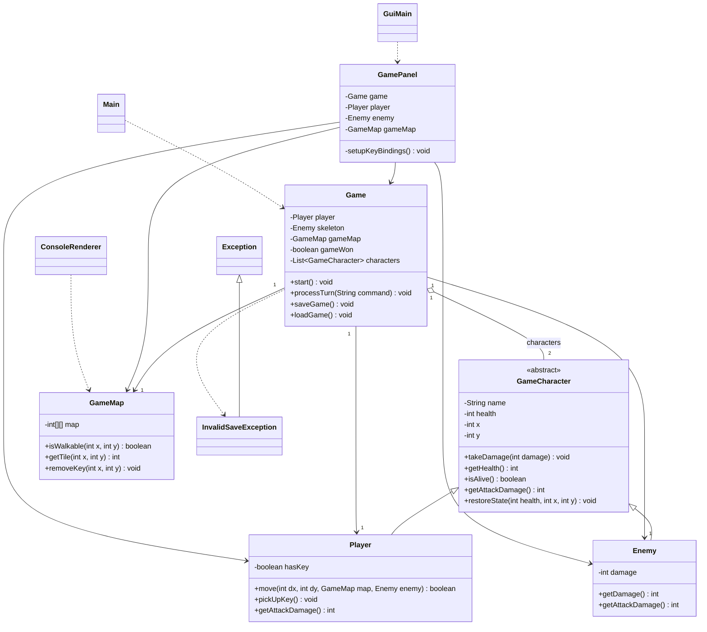

# UML Class Diagram

This diagram shows the main classes of my Dungeon Crawler game.

## Design pattern

I used the Command pattern with Swing AbstractAction.

In GamePanel, the keyboard keys are connected to actions.
These actions call methods in the Game class.

This keeps keyboard input separate from the game logic.
